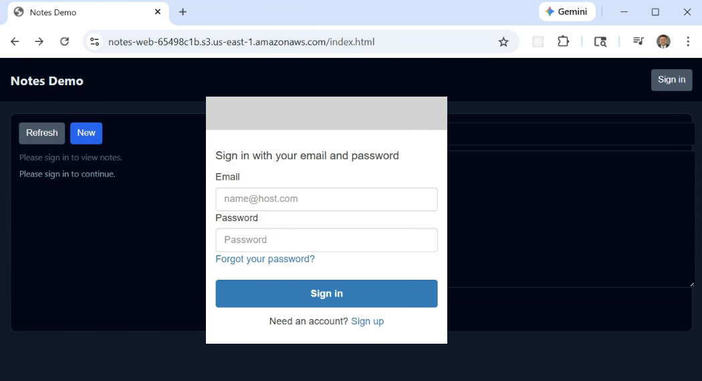

# Authenticated CRUD API on AWS: Cognito, API Gateway, Lambda and DynamoDB

The [aws-crud-example](https://github.com/mamonaco1973/aws-crud-example)
notes API with sign-in added. Users sign in with **Amazon Cognito** through
the Hosted UI, an **API Gateway HTTP API** checks their token with a **JWT
authorizer** before any **Lambda** function runs, and each user's notes are
kept separate in **DynamoDB** by their Cognito user ID. A single-page web app
on a public **S3** bucket handles the sign-in and calls the API.



| Piece | Where | Role |
|---|---|---|
| **notes-user-pool** | Cognito, us-east-1 | email sign-in, verified email, 12-character passwords; Hosted UI on `notes-auth-<hex>`; a public SPA client using the authorization code flow, with callback `callback.html` |
| **notes-api-cognito** | API Gateway | HTTP API, `$default` stage; five routes, all behind the `cognito-jwt` authorizer (issuer: the user pool, audience: the SPA client); CORS allows any origin and the `authorization` header |
| **Lambda functions** | us-east-1 | `create-note-cognito`, `list-notes-cognito`, `get-note-cognito`, `update-note-cognito`, `delete-note-cognito`; Python 3.14, all from `code/notes.py`; each role allows one DynamoDB action |
| **notes-cognito** | DynamoDB | on-demand table keyed on `owner` (the token's `sub`) and `id` |
| **cnotes-web-&lt;hex&gt;** | S3 | public-read bucket with `index.html`, `callback.html`, `config.json` and `favicon.ico` |

## Architecture

<picture>
  <source media="(prefers-color-scheme: dark)" srcset="architecture-dark.svg">
  
</picture>

Regenerate with `python3 make_diagram.py`.

- **`01-lambdas/`**: the user pool, domain and client (`cognito.tf`), the
  API with its authorizer and routes (`api.tf`), the table, one
  `lambda-*.tf` per function with its role, the web bucket (`s3.tf`), and
  the handlers in `code/notes.py`.
- **`02-webapp/`**: `index.html.tmpl`, `callback.html` and the upload of the
  rendered files and `config.json`.

## How sign-in works

1. The page sends the user to the Cognito Hosted UI with a PKCE challenge
   and a random `state`.
2. Cognito redirects back to `callback.html`, which checks the `state`,
   exchanges the code (with the PKCE verifier) for tokens, and keeps them in
   `sessionStorage`.
3. Every API call sends the access token as `Authorization: Bearer <token>`.
   API Gateway validates it against the user pool before invoking a
   function, so unauthenticated calls never reach Lambda.
4. Each function reads the `sub` claim API Gateway passes in and uses it as
   the `owner` key, so users only see and change their own notes.

## API

Every route needs a valid Cognito token.

| Method | Path | Function | Returns |
|---|---|---|---|
| POST | `/notes` | `create-note-cognito` | `201` `{id, title, note}`; `400` if `title` or `note` is missing |
| GET | `/notes` | `list-notes-cognito` | `{"items": [...]}` for this user |
| GET | `/notes/{id}` | `get-note-cognito` | the note, or `404` |
| PUT | `/notes/{id}` | `update-note-cognito` | the updated note; `404` if it doesn't exist |
| DELETE | `/notes/{id}` | `delete-note-cognito` | `{"message": "Note deleted"}`, or `404` |

## Prerequisites

* [An AWS Account](https://aws.amazon.com/console/)
* [Install AWS CLI](https://docs.aws.amazon.com/cli/latest/userguide/getting-started-install.html)
* [Install Terraform](https://developer.hashicorp.com/terraform/install)
* [Install jq](https://jqlang.github.io/jq/download/) and `envsubst`

If this is your first time following along, we recommend starting with this
video: [AWS + Terraform: Easy Setup](https://www.youtube.com/watch?v=9clW3VQLyxA).

## Deploy

```bash
git clone https://github.com/mamonaco1973/aws-cognito-app.git
cd aws-cognito-app
./apply.sh
```

Everything deploys to `us-east-1`. `apply.sh` applies `01-lambdas`, renders
`index.html` with the API URL, writes `config.json` with the Cognito domain,
client ID and redirect URIs, and applies `02-webapp` to upload them. It ends
by running `validate.sh`, which prints the URLs:

```
=================================================================================
  Deployment validated!
=================================================================================
  API : https://<api-id>.execute-api.us-east-1.amazonaws.com
  Web : https://cnotes-web-<hex>.s3.us-east-1.amazonaws.com/index.html
=================================================================================
```

## Try it

1. Open the **Web** URL and choose **Sign in**. In the Hosted UI, choose
   **Sign up**, register with your email, and enter the code Cognito sends.
2. Add, edit and delete notes. Sign in as a second user to see that each
   account has its own notes.
3. Call the API without a token and you get `401 Unauthorized`:

   ```bash
   curl -i https://<api-id>.execute-api.us-east-1.amazonaws.com/notes
   ```

## Teardown

```bash
./destroy.sh
```

## Notes

- **Lab only.** Anyone can sign up through the Hosted UI, and the API allows
  CORS from any origin.
